  
  <h1>👨‍🍳 Zinthaw Tun</h1>
  
<strong>Always cooking. Currently cooking: agentic software development life cycle.</strong>

  
Developer exploring how AI agents can plan, build, test, and ship software alongside humans.

---

### 🍳 What's on the stove

- 🤖 **Agentic SDLC research:** how autonomous coding agents fit into every stage of the software lifecycle, from requirements to review and release.
- 🧪 **AI-assisted engineering:** practical workflows, guardrails, and evaluation for working with LLM coding tools.
- 📚 **RAG & LLM apps:** retrieval, grounding, and building useful AI-powered tools.

### 🧂 Ingredients

`TypeScript` · `JavaScript` · `C#` · `.NET` · `Python` · `React` · `Next.js` · `LLMs` · `AI agents`

### 🔥 Kitchen rules

1. Let agents do the chopping; humans own the taste.
2. Every dish gets tested before it's served.
3. Ship small, iterate often, keep cooking.

  🍽️ Something's always simmering. Follow along to see what's served next.

